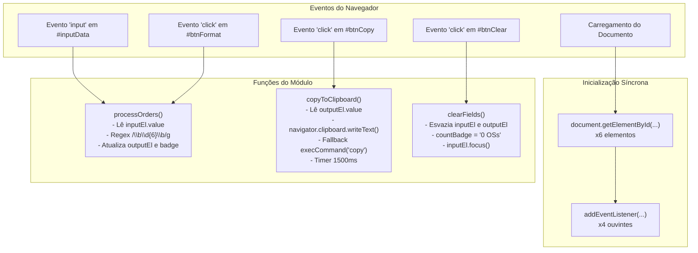
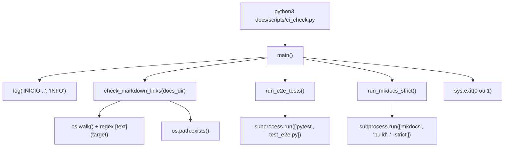

# Mapa Arquitetural do Sistema (DOCS_MAP.md)

Este documento mapeia todos os componentes de software, pontos de entrada, fluxo de dados, dependências e símbolos ordenados por criticidade de risco do repositório [VERIFICADO: gerado a partir de inspeção de AST e grafo de execução].

---

## 1. Pontos de Entrada do Sistema (*Entry Points*)

| Componente / Arquivo | Tipo de Ponto de Entrada | Mecanismo de Disparo | Papel no Sistema |
| :--- | :--- | :--- | :--- |
| [index.html:200-286](file:///home/brunocr/Documentos/SMAURB/Projeto%20Ordena%C3%A7%C3%A3o%20OS/index.html#L200-L286) | Interface Web Client-Side (SPA) | Carregamento no navegador (`file://` ou `http://`) | Ponto de entrada do usuário final para extração e formatação de OSs. |
| [docs/scripts/ci_check.py:126](file:///home/brunocr/Documentos/SMAURB/Projeto%20Ordena%C3%A7%C3%A3o%20OS/docs/scripts/ci_check.py#L126) | Linha de Comando (CLI) / Pipeline | Execução via `python3 docs/scripts/ci_check.py` | Ponto de entrada do pipeline de validação de integridade e CI. |
| [docs/tests/test_e2e.py](file:///home/brunocr/Documentos/SMAURB/Projeto%20Ordena%C3%A7%C3%A3o%20OS/docs/tests/test_e2e.py) | Suíte de Testes Automatizados | Execução via `pytest docs/tests/test_e2e.py` | Ponto de entrada para regressão e especificação formal de comportamento. |

---

## 2. Módulos e Responsabilidades

```
Projeto Ordenação OS /
├── index.html                  [Módulo Principal de Apresentação e Extração]
│   ├── CSS (<style> L7-198)    -> Estilização de layout, responsividade mobile (@media <= 680px), estados interativos
│   ├── DOM (<main> L202-225)   -> Estrutura semântica (card, textareas, badge, botões)
│   └── JS (<script> L227-284)  -> Lógica reativa: extração regex \b\d{6}\b, integração clipboard, reset de estado
├── docs/scripts/ci_check.py    [Módulo de Integração Contínua e Integridade]
│   ├── Validador de Links Markdown -> Varre AST/Regex de links [texto](alvo) e checa existência física
│   ├── Executor E2E Pytest         -> Subprocesso de testes de interface headless
│   └── Compilador Estrito MkDocs   -> Validação de compilação sem alertas (--strict)
└── docs/tests/test_e2e.py      [Módulo de Especificação e Testes de Regressão]
    ├── Fixture driver (Chrome)     -> Instanciação de navegador headless isolado
    └── 9 Casos de Teste            -> Validação de extração, pontuações, não ordenação, clipboard e responsividade
```

---

## 3. Grafo de Chamadas do Sistema (*Call Graph*)

### 3.1 Grafo de Chamadas - Frontend (`index.html`)



### 3.2 Grafo de Chamadas - Pipeline de CI (`docs/scripts/ci_check.py`)



---

## 4. Fluxo Principal de Dados

```mermaid
sequenceDiagram
    autonumber
    participant Origem as Texto Bruto (E-mail/Relatório)
    participant Input as inputEl (#inputData)
    participant Regex as Engine RegExp (/\b\d{6}\b/g)
    participant Join as Array.join(';')
    participant Output as outputEl (#outputData)
    participant OS as Área de Transferência do SO
    participant Destino as Sistema Destino (Excel/ERP)

    Origem->>Input: Colar bloco não estruturado (Ctrl+V)
    Input->>Regex: Dispara evento 'input' -> avalia texto
    Regex->>Join: Retorna array de casamentos (matches)
    Join->>Output: Preenche string delimitada por ';'
    Output->>OS: Usuário clica em 'Copiar' -> navigator.clipboard
    OS->>Destino: Operador cola no destino (Ctrl+V)
```

---

## 5. Dependências Externas

- **Produção (`index.html`)**: **Zero dependências externas**. Sem CDN, sem frameworks, sem fontes remotas. Apenas Web APIs nativas da W3C / ECMAScript padrão.
- **Ambiente de Testes e CI**:
  - `python` 3.12+ (interpretador base)
  - `selenium` 4.51.0 (driver de automação web)
  - `pytest` 9.1.1 (framework de execução de testes)
  - `mkdocs` 1.6.1 + `mkdocs-material` 9.7.7 (geração estrita da documentação)
  - `google-chrome` 128+ (navegador headless para execução do V8 e renderização de layout)

---

## 6. Símbolos do Sistema Ordenados por Risco (Centralidade × Complexidade)

Critério de ordenação:
- **Centralidade** (1 a 5): Relevância funcional no caminho crítico de execução do negócio.
- **Complexidade** (1 a 5): Presença de ramos assíncronos, lógica de expressão regular, manipulação de filesystem ou estado temporal.
- **Risco** = Centralidade × Complexidade.

| Ordem | Símbolo | Arquivo | Centralidade (1-5) | Complexidade (1-5) | Índice de Risco | Justificativa do Risco |
| :---: | :--- | :--- | :---: | :---: | :---: | :--- |
| **1** | `processOrders` | `index.html` | 5 | 4 | **20** | Núcleo do produto. Extração léxica de OS via regex, formatação delimitada e lógica singular/plural do badge. |
| **2** | `copyToClipboard` | `index.html` | 4 | 4 | **16** | Exportação de dados. Envolve async/await, tratamento de exceções de permissão do browser, fallback legado e timers de UI. |
| **3** | `check_markdown_links` | `docs/scripts/ci_check.py` | 3 | 5 | **15** | Guardião da documentação. Parsing de links, normalização de caminhos relativos e absolutos com URL unquote. |
| **4** | `test_regex_boundary_and_length_rules` | `docs/tests/test_e2e.py` | 4 | 3 | **12** | Especificação viva de limites da regex (5 vs 6 vs 7 dígitos, fronteiras de pontuação vs caracteres de palavra). |
| **5** | `test_non_sorting_and_non_deduplication` | `docs/tests/test_e2e.py` | 4 | 3 | **12** | Auditoria direta da divergência entre a nomenclatura do projeto e a ausência real de ordenação/deduplicação. |
| **6** | `test_copy_button_and_feedback` | `docs/tests/test_e2e.py` | 3 | 4 | **12** | Teste assíncrono com WebDriverWait do estado de transição visual do botão Copiar (1500ms). |
| **7** | `driver` | `docs/tests/test_e2e.py` | 4 | 2 | **8** | Fixture base de inicialização e desligamento do Google Chrome Headless com flags de sandbox e GPU. |
| **8** | `clearFields` | `index.html` | 3 | 2 | **6** | Reset de estado global de campos no DOM e devolução de foco de teclado. |
| **9** | `run_e2e_tests` | `docs/scripts/ci_check.py` | 3 | 2 | **6** | Subprocesso de automação para execução de pytest capturando stdout e exit codes. |
| **10**| `run_mkdocs_strict` | `docs/scripts/ci_check.py` | 3 | 2 | **6** | Validador estrito de compilação da documentação contra advertências de links e sintaxe. |
| **11**| `main` | `docs/scripts/ci_check.py` | 3 | 2 | **6** | Ponto de entrada e agregação dos retornos booleanos de cada etapa do pipeline de CI. |
| **12**| `log` | `docs/scripts/ci_check.py` | 2 | 2 | **4** | Emissão formatada com escape codes ANSI de status (INFO, PASS, FAIL, WARN). |
| **13**| `test_initial_page_state` | `docs/tests/test_e2e.py` | 3 | 1 | **3** | Validação de sanidade do carregamento inicial do DOM e valores padrão. |
| **14**| `test_extraction_on_input_event` | `docs/tests/test_e2e.py` | 3 | 1 | **3** | Validação do evento `input` em tempo real. |
| **15**| `test_singular_plural_badge` | `docs/tests/test_e2e.py` | 3 | 1 | **3** | Verificação de concordância de número no badge. |
| **16**| `test_format_button_click` | `docs/tests/test_e2e.py` | 2 | 1 | **2** | Verificação de redundância do clique no botão Formatar. |
| **17**| `test_clear_button` | `docs/tests/test_e2e.py` | 2 | 1 | **2** | Validação funcional do botão Limpar. |
| **18**| `test_responsive_mobile_viewport` | `docs/tests/test_e2e.py` | 2 | 1 | **2** | Validação de renderização sob viewport móvel 480x800. |
