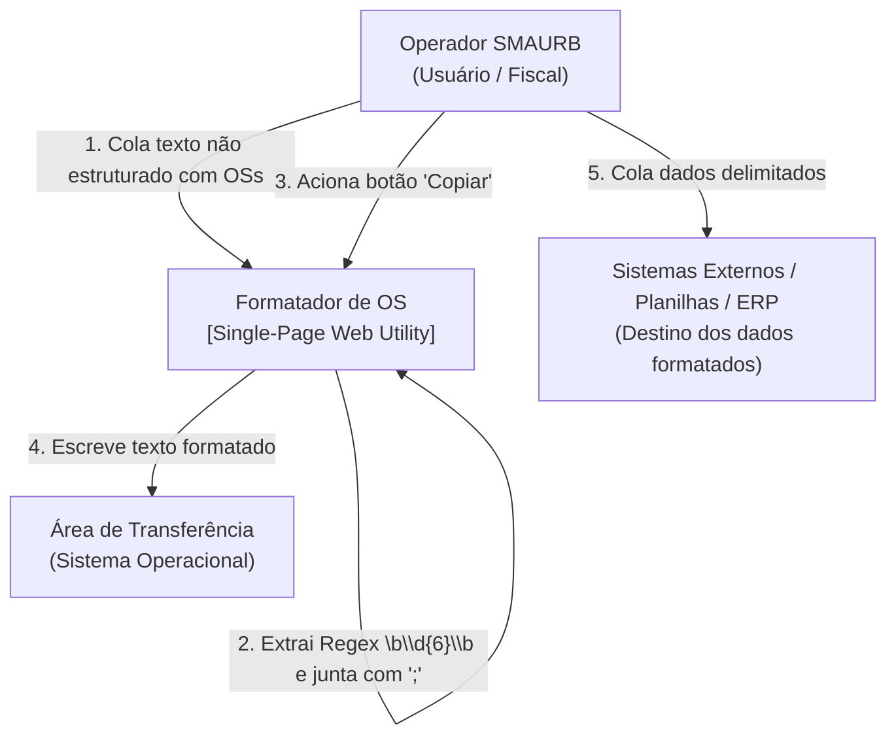
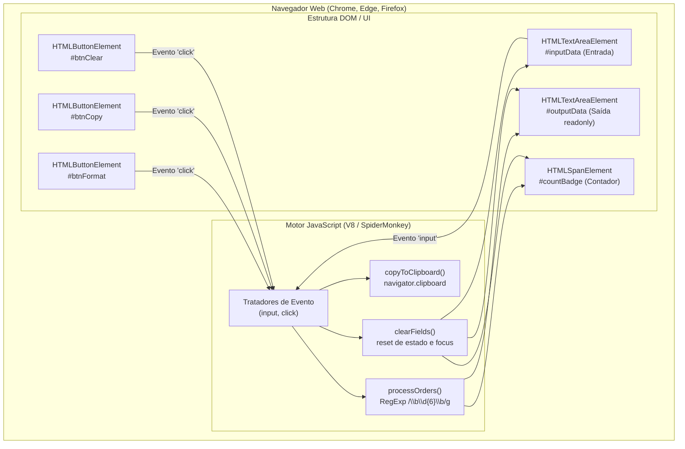
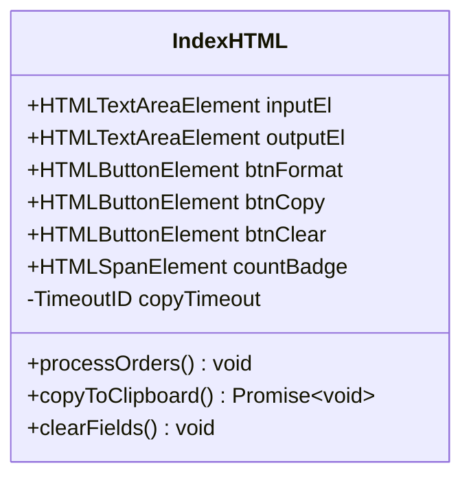

# 2. Arquitetura do Sistema e Visão de Componentes (C4 / arc42)

## 2.1 Modelo C4 - Nível 1: Diagrama de Contexto de Sistema

O sistema opera isolado na estação de trabalho do usuário, interagindo exclusivamente com a Área de Transferência do Sistema Operacional e o operador humano [LIDO NO CÓDIGO: index.html:227-284] [VERIFICADO: execução sem tráfego de rede].



## 2.2 Modelo C4 - Nível 2: Diagrama de Contêiner

A aplicação é monolítica e autocontida em um único contêiner de entrega: o navegador web do usuário executando o arquivo local `index.html` [LIDO NO CÓDIGO: index.html:1-286].



## 2.3 Modelo C4 - Nível 3: Diagrama de Componentes

Detalhamento dos componentes internos e suas fronteiras no script [index.html:227-284](file:///home/brunocr/Documentos/SMAURB/Projeto%20Ordena%C3%A7%C3%A3o%20OS/index.html#L227-L284):

| Componente | Linhas no Código | Responsabilidade Primária | Dependências |
| :--- | :--- | :--- | :--- |
| **Parser Engine** | [index.html:237-249](file:///home/brunocr/Documentos/SMAURB/Projeto%20Ordena%C3%A7%C3%A3o%20OS/index.html#L237-L249) | Extração por expressão regular e concatenação com `;` | `String.prototype.match`, `Array.prototype.join` [LIDO NO CÓDIGO] |
| **Badge Controller** | [index.html:244, 247, 276](file:///home/brunocr/Documentos/SMAURB/Projeto%20Ordena%C3%A7%C3%A3o%20OS/index.html#L244) | Formatação de string de contagem ("0 OSs", "1 OS", "N OSs") | `Node.textContent` [LIDO NO CÓDIGO] |
| **Clipboard Service** | [index.html:251-271](file:///home/brunocr/Documentos/SMAURB/Projeto%20Ordena%C3%A7%C3%A3o%20OS/index.html#L251-L271) | Escrita na área de transferência com fallback síncrono e controle de timer visual | `navigator.clipboard.writeText`, `document.execCommand`, `setTimeout` [LIDO NO CÓDIGO] |
| **Form Reset Controller** | [index.html:273-278](file:///home/brunocr/Documentos/SMAURB/Projeto%20Ordena%C3%A7%C3%A3o%20OS/index.html#L273-L278) | Restauração de campos para string vazia e reatribuição de foco | `HTMLElement.focus` [LIDO NO CÓDIGO] |



## 2.4 Grafo de Dependências entre Módulos
Como a aplicação é monofólio (*single-file*), o grafo de dependências externas é nulo:
```
[index.html]
   ├── CSS embutido (<style> L7-198): 0 dependências externas (sem fontes web remotas, usando fontes do sistema operacional - L15)
   └── JS embutido (<script> L227-284): 0 dependências externas (ECMAScript padrão + Web APIs)
```
[VERIFICADO: ausência de qualquer chamada de rede externa durante o carregamento no Chrome headless].
