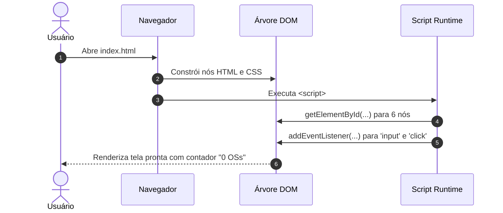
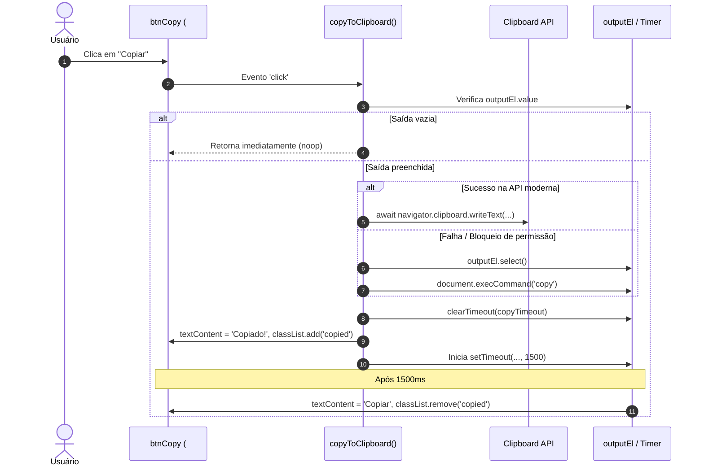

# 3. Visão de Execução: Fluxos Principais Passo a Passo

## 3.1 Fluxo 1: Inicialização do Ciclo de Vida da Aplicação
Ao abrir o arquivo [index.html](file:///home/brunocr/Documentos/SMAURB/Projeto%20Ordena%C3%A7%C3%A3o%20OS/index.html) no navegador:
1. O parser HTML analisa os elementos do corpo `<main class="card">` [LIDO NO CÓDIGO: index.html:202-225].
2. O script inline síncrono é executado [LIDO NO CÓDIGO: index.html:227-284]:
   - Linhas 228-233: busca os ponteiros dos elementos no DOM via `document.getElementById`: `inputData`, `outputData`, `btnFormat`, `btnCopy`, `btnClear`, `countBadge`.
   - Linha 235: declara a variável global de controle de timer `let copyTimeout = null;`.
   - Linhas 280-283: registra os ouvintes de eventos (*event listeners*):
     - `inputEl.addEventListener('input', processOrders)` [LIDO NO CÓDIGO: index.html:280]
     - `btnFormat.addEventListener('click', processOrders)` [LIDO NO CÓDIGO: index.html:281]
     - `btnCopy.addEventListener('click', copyToClipboard)` [LIDO NO CÓDIGO: index.html:282]
     - `btnClear.addEventListener('click', clearFields)` [LIDO NO CÓDIGO: index.html:283]
3. O estado inicial apresenta os campos vazios e o badge com o texto literal `"0 OSs"` [LIDO NO CÓDIGO: index.html:205] [VERIFICADO: teste `test_initial_page_state`].



## 3.2 Fluxo 2: Processamento e Extração de Ordens de Serviço
Este fluxo é disparado automaticamente tanto pelo evento `input` na área de texto [index.html:280](file:///home/brunocr/Documentos/SMAURB/Projeto%20Ordena%C3%A7%C3%A3o%20OS/index.html#L280) quanto pelo clique no botão `#btnFormat` [index.html:281](file:///home/brunocr/Documentos/SMAURB/Projeto%20Ordena%C3%A7%C3%A3o%20OS/index.html#L281).

1. Lê `inputEl.value` como `rawText` [LIDO NO CÓDIGO: index.html:238].
2. Executa `rawText.match(/\b\d{6}\b/g)` [LIDO NO CÓDIGO: index.html:239]:
   - `\b`: Fronteira de palavra (delimitador de início e fim que não seja caractere de palavra `\w`).
   - `\d{6}`: Exatamente 6 dígitos numéricos decimais consecutivos (0-9).
   - `/g`: Flag global para retornar todos os casamentos encontrados como um array de strings.
3. Se `matches` for avaliado como verdadeiro e `matches.length > 0` [LIDO NO CÓDIGO: index.html:241]:
   - Concatena os elementos do array com ponto e vírgula: `outputEl.value = matches.join(';')` [LIDO NO CÓDIGO: index.html:242].
   - Avalia a expressão ternária: `${total} OS${total === 1 ? '' : 's'}` [LIDO NO CÓDIGO: index.html:244].
   - Atualiza `countBadge.textContent` com `"1 OS"` se total for 1, ou `"${total} OSs"` se total for maior que 1 [VERIFICADO: teste `test_singular_plural_badge`].
4. Caso contrário (se não houver casamentos, retornando `null`):
   - Atribui string vazia a `outputEl.value = ''` [LIDO NO CÓDIGO: index.html:246].
   - Restaura `countBadge.textContent = '0 OSs'` [LIDO NO CÓDIGO: index.html:247].

```mermaid
sequenceDiagram
    autonumber
    actor User as Usuário
    participant Input as inputEl (#inputData)
    participant Core as processOrders()
    participant Output as outputEl (#outputData)
    participant Badge as countBadge (#countBadge)

    User->>Input: Digita ou cola texto
    Input->>Core: Dispara evento 'input'
    Core->>Input: Lê .value
    Core->>Core: Executa rawText.match(/\\b\\d{6}\\b/g)
    alt Casamentos encontrados (matches.length > 0)
        Core->>Output: Atribui matches.join(';')
        Core->>Badge: Atribui `${total} OS${total === 1 ? '' : 's'}`
    else Nenhum casamento (matches === null)
        Core->>Output: Atribui ''
        Core->>Badge: Atribui '0 OSs'
    end
```

## 3.3 Fluxo 3: Cópia para a Área de Transferência
Disparado pelo clique no botão `#btnCopy` [index.html:282](file:///home/brunocr/Documentos/SMAURB/Projeto%20Ordena%C3%A7%C3%A3o%20OS/index.html#L282).

1. Lê `outputEl.value` como `textToCopy` [LIDO NO CÓDIGO: index.html:252].
2. Se `!textToCopy` for verdadeiro (campo vazio), interrompe a execução imediatamente via `return` antecipado sem alterar o DOM nem o botão [LIDO NO CÓDIGO: index.html:253] [VERIFICADO: clique com saída vazia mantém o botão inalterado].
3. Se houver conteúdo, tenta a API moderna assíncrona: `await navigator.clipboard.writeText(textToCopy)` [LIDO NO CÓDIGO: index.html:256].
4. Se o contexto de segurança ou permissão falhar (rejeição da Promise), cai no bloco `catch`:
   - Seleciona o texto de saída: `outputEl.select()` [LIDO NO CÓDIGO: index.html:258].
   - Executa o comando legado do navegador: `document.execCommand('copy')` [LIDO NO CÓDIGO: index.html:259].
5. Cancela qualquer temporizador pendente chamando `clearTimeout(copyTimeout)` [LIDO NO CÓDIGO: index.html:262].
6. Aplica o feedback visual de sucesso:
   - Modifica o texto do botão: `btnCopy.textContent = 'Copiado!'` [LIDO NO CÓDIGO: index.html:264].
   - Adiciona a classe CSS: `btnCopy.classList.add('copied')` [LIDO NO CÓDIGO: index.html:265] (altera fundo para `#e8f5e9` e borda para `#a5d6a7` [LIDO NO CÓDIGO: index.html:161-165]).
7. Inicia um temporizador de 1.500 milissegundos (`setTimeout`) [LIDO NO CÓDIGO: index.html:267]:
   - Ao disparar o callback, restaura `btnCopy.textContent = 'Copiar'` [LIDO NO CÓDIGO: index.html:268].
   - Remove a classe: `btnCopy.classList.remove('copied')` [LIDO NO CÓDIGO: index.html:269] [VERIFICADO: teste `test_copy_button_and_feedback`].



## 3.4 Fluxo 4: Limpeza Completa de Dados
Disparado pelo clique no botão `#btnClear` [index.html:283](file:///home/brunocr/Documentos/SMAURB/Projeto%20Ordena%C3%A7%C3%A3o%20OS/index.html#L283).

1. Limpa o valor de entrada: `inputEl.value = ''` [LIDO NO CÓDIGO: index.html:274].
2. Limpa o valor de saída: `outputEl.value = ''` [LIDO NO CÓDIGO: index.html:275].
3. Redefine o badge de contagem: `countBadge.textContent = '0 OSs'` [LIDO NO CÓDIGO: index.html:276].
4. Move o foco do teclado de volta para o campo de entrada: `inputEl.focus()` [LIDO NO CÓDIGO: index.html:277] [VERIFICADO: teste `test_clear_button`].
