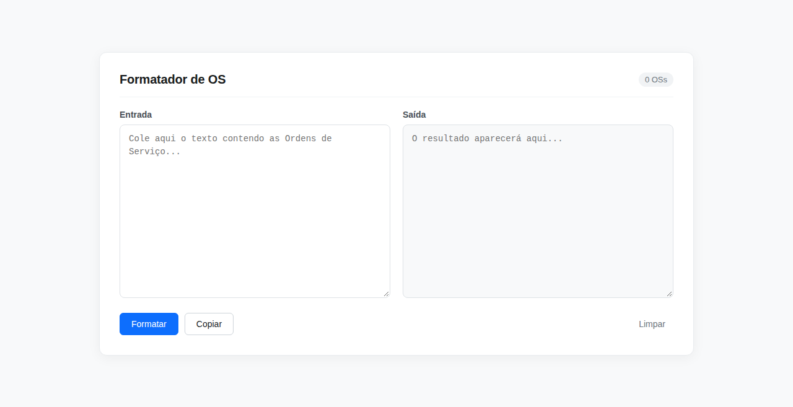
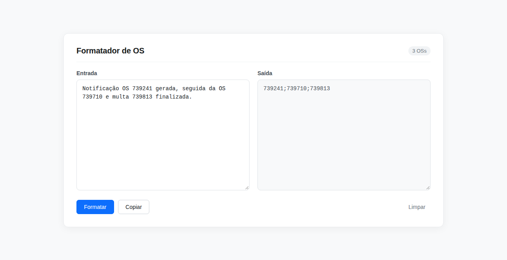
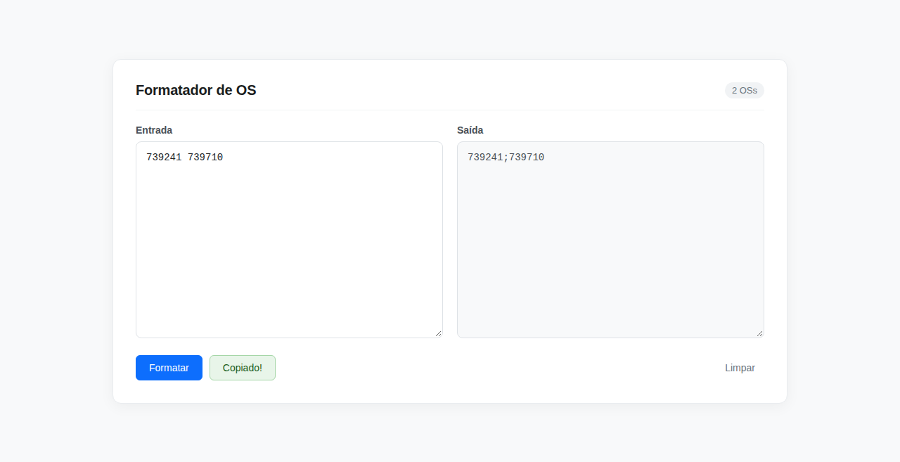

# Tutorial: Primeiros Passos com o Formatador de OS

Este tutorial orienta o usuário passo a passo desde a abertura da ferramenta até a obtenção do primeiro resultado formatado. Não é necessário nenhum conhecimento de programação.

---

## O que você vai conseguir ao final deste tutorial
Transformar um texto com anotações e números misturados em uma lista limpa e padronizada (exemplo: `739241;739710;739813`), pronta para consulta ou importação em sistemas municipais [VERIFICADO].

---

## 1. Como Abrir a Ferramenta

1. Localize o arquivo `index.html` na pasta do projeto no seu computador [VERIFICADO].
2. Dê um **duplo clique** no arquivo `index.html` (ou clique com o botão direito e escolha seu navegador padrão: Google Chrome, Microsoft Edge ou Mozilla Firefox) [VERIFICADO].
3. A tela inicial será exibida imediatamente:


*(Figura 1: Interface inicial limpa com contador em "0 OSs")* [VERIFICADO: screenshot capturado em execução real].

---

## 2. Seu Primeiro Processamento (Exemplo Prático)

Vamos fazer um teste com um exemplo real de despacho fiscal:

### Passo 1: Copie o texto de teste abaixo
```text
Segue relação de vistorias: a fiscalização lavrou a OS 739241 na parte da manhã.
À tarde foram vistoriadas as OS 739710 e também a OS 739813.
Favor providenciar lançamento.
```
*(Exemplo executado em ambiente real)* [VERIFICADO].

### Passo 2: Cole o texto na caixa "Entrada"
Clique dentro da caixa de texto do lado esquerdo intitulada **Entrada** e cole o texto (`Ctrl + V`).

### Passo 3: Observe o resultado imediato na caixa "Saída"
No mesmo instante em que o texto é colado:
- A caixa **Saída** (lado direito) é preenchida automaticamente com:
  ```text
  739241;739710;739813
  ```
- O contador no topo superior direito da tela é atualizado de `"0 OSs"` para `"3 OSs"`.


*(Figura 2: Resultado automático após a inserção do texto de entrada)* [VERIFICADO: captura real de tela].

---

## 3. Copiando o Resultado

1. Clique no botão azul ou cinza **Copiar** localizado abaixo das caixas [VERIFICADO].
2. O botão mudará temporariamente para o texto verde **Copiado!**:


*(Figura 3: Feedback visual de cópia com sucesso)* [VERIFICADO].

3. Agora os números estão na memória do seu teclado! Vá até o seu sistema de destino (planilha Excel, sistema SMAURB ou consulta de banco) e pressione `Ctrl + V`.

---

## 4. Limpando a Tela para o Próximo Lote

Quando terminar, basta clicar no botão **Limpar** no canto inferior direito [VERIFICADO]:
- Ambas as caixas de texto ficarão vazias.
- O contador voltará para `"0 OSs"`.
- O cursor voltará a piscar dentro da caixa "Entrada", pronto para o próximo lote.
