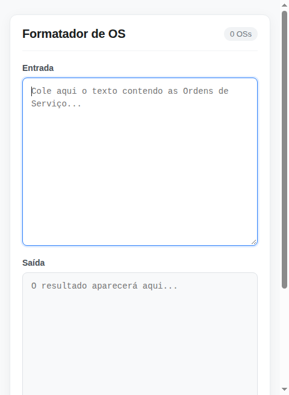

# Referência da Interface do Usuário

Guia de referência exaustivo cobrindo todos os elementos visuais, campos de texto, botões e comportamentos responsivos da tela [LIDO NO CÓDIGO: index.html:1-286].

---

## 1. Mapa de Elementos da Interface

```
+------------------------------------------------------------------------+
| Formatador de OS                                               [ 0 OSs]|  <- Cabeçalho
+-----------------------------------+------------------------------------+
| Entrada                           | Saída                              |
| [                               ] | [                                ] |  <- Áreas de Texto
| [ Cole aqui o texto...          ] | [ O resultado aparecerá aqui...  ] |
| [                               ] | [                                ] |
+-----------------------------------+------------------------------------+
| [ Formatar ]  [ Copiar ]                                     [ Limpar ]|  <- Barra de Ações
+------------------------------------------------------------------------+
```

---

## 2. Detalhamento dos Componentes

### 2.1 Cabeçalho e Contador
* **Título Principal (`<h1>`)**: Exibe o texto estático `"Formatador de OS"` [LIDO NO CÓDIGO: index.html:204].
* **Selo de Contagem (`#countBadge`)**:
  - Elemento: `<span class="counter" id="countBadge">` [LIDO NO CÓDIGO: index.html:205].
  - Estado Inicial: `"0 OSs"` com fundo cinza claro (`#f1f3f5`) [LIDO NO CÓDIGO: index.html:57].
  - Regra de Flexão Gramatical:
    - 0 correspondências: `"0 OSs"` [LIDO NO CÓDIGO: index.html:247].
    - 1 correspondência: `"1 OS"` (singular, suprime o 's') [LIDO NO CÓDIGO: index.html:244] [VERIFICADO].
    - 2 ou mais: `"${total} OSs"` (plural) [LIDO NO CÓDIGO: index.html:244] [VERIFICADO].

### 2.2 Áreas de Texto
* **Entrada (`#inputData`)**:
  - Elemento: `<textarea id="inputData">` [LIDO NO CÓDIGO: index.html:211].
  - *Placeholder*: `"Cole aqui o texto contendo as Ordens de Serviço..."`.
  - Propriedades: Editável, redimensionável verticalmente (`resize: vertical`), foco destacado com borda azul e sombra (`box-shadow: 0 0 0 3px rgba(13, 110, 253, 0.15)`) [LIDO NO CÓDIGO: index.html:98].
  - Verificação Ortográfica: Desativada (`spellcheck="false"`) para evitar marcações vermelhas em números [LIDO NO CÓDIGO: index.html:211].

* **Saída (`#outputData`)**:
  - Elemento: `<textarea id="outputData" readonly>` [LIDO NO CÓDIGO: index.html:216].
  - *Placeholder*: `"O resultado aparecerá aqui..."`.
  - Propriedades: Somente leitura (`readonly`). Não permite digitação direta pelo usuário para evitar adulteração involuntária dos dados formatados [LIDO NO CÓDIGO: index.html:101-105].

### 2.3 Botões de Ação
* **Botão "Formatar" (`#btnFormat`)**:
  - Estilo: `.btn-primary` (Fundo azul `#0d6efd`, texto branco) [LIDO NO CÓDIGO: index.html:135-139].
  - Função: Dispara manualmente a função `processOrders()`, extraindo os números e atualizando a saída [LIDO NO CÓDIGO: index.html:281].

* **Botão "Copiar" (`#btnCopy`)**:
  - Estilo Padrão: `.btn-secondary` (Fundo branco `#ffffff`, borda cinza `#ced4da`, texto escuro) [LIDO NO CÓDIGO: index.html:150-154].
  - Estilo Ativo (`.copied`): Ao ser acionado com dados presentes, transita para fundo verde claro `#e8f5e9`, borda verde `#a5d6a7` e texto `#1b5e20`, exibindo o texto `"Copiado!"` durante 1.500ms antes de retornar ao estado original [LIDO NO CÓDIGO: index.html:161-165, 267-270] [VERIFICADO].

* **Botão "Limpar" (`#btnClear`)**:
  - Estilo: `.btn-clear` (Fundo transparente, alinhado à extrema direita com `margin-left: auto`) [LIDO NO CÓDIGO: index.html:167-174].
  - Função: Esvazia ambas as caixas de texto, reseta o badge e move o foco para `#inputData` [LIDO NO CÓDIGO: index.html:273-278] [VERIFICADO].

---

## 3. Atalhos de Teclado Suportados

A aplicação responde nativamente aos atalhos de edição de texto do sistema operacional quando o campo de Entrada está em foco:

| Atalho de Teclado | Ação Realizada no Sistema |
| :--- | :--- |
| `Ctrl + V` (Windows/Linux) / `Cmd + V` (macOS) | Cola o texto da área de transferência e aciona o processamento reativo instantâneo [VERIFICADO] |
| `Ctrl + A` (Windows/Linux) / `Cmd + A` (macOS) | Seleciona todo o conteúdo do campo ativo [VERIFICADO] |
| `Ctrl + Z` (Windows/Linux) / `Cmd + Z` (macOS) | Desfaz a última edição de digitação |
| `Tab` | Alterna o foco entre Entrada -> Saída -> Botão Formatar -> Botão Copiar -> Botão Limpar [VERIFICADO] |

---

## 4. Adaptação para Telas Estreitas e Dispositivos Móveis

Quando a largura da tela é inferior a 680 pixels (`@media (max-width: 680px)`) [LIDO NO CÓDIGO: index.html:180-197]:
- As duas caixas de texto deixam de ficar lado a lado e passam a se empilhar em uma única coluna vertical [LIDO NO CÓDIGO: index.html:186] [VERIFICADO: teste `test_responsive_mobile_viewport`].
- O botão Limpar assume 100% da largura (`width: 100%`) [LIDO NO CÓDIGO: index.html:191].
- Todos os botões ganham flexibilidade de expansão horizontal (`flex: 1 1 auto`) para facilitar o toque na tela [LIDO NO CÓDIGO: index.html:195].


*(Figura 4: Adaptação de layout para telas de até 480px de largura)* [VERIFICADO: screenshot gerado no teste E2E].
